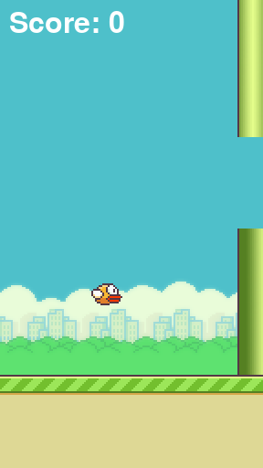

# 🐦 Flappy Bird

A retro-style **Flappy Bird clone** built with **Pygame**. Guide the little bird through gaps between endlessly scrolling pipes — every pipe you pass earns a point, and one bad flap ends the run.



## 🎮 Gameplay

- 🏃 Endless side-scrolling pipes with randomized gap heights
- 🏆 Live **Score** counter in the top-left corner
- 💥 Crashing into a pipe ends the game
- 🔊 Sound effects for flapping, scoring, hitting and dying
- 🖼️ Classic 288×512 portrait window with pixel-art assets

## 🕹️ Controls

| Action | Key |
| ------ | --- |
| Flap / rise | `SPACE` (hold to keep rising) |
| Quit | Close the window |

## 🚀 How to Run

```bash
pip install pygame
cd "Flappy Bird"
python main.py
```

> ⚠️ Run the game **from inside its folder** — images and sounds are loaded with relative paths.

## 📁 Project Structure

```text
Flappy Bird/
├── main.py
├── Images/   # bird, pipes, background, base
└── Sounds/   # wing, point, hit, die, swoosh
```

## 🧰 Requirements

- 🐍 Python 3.8+
- 🎮 Pygame 2.x (tested with pygame 2.6.1)
