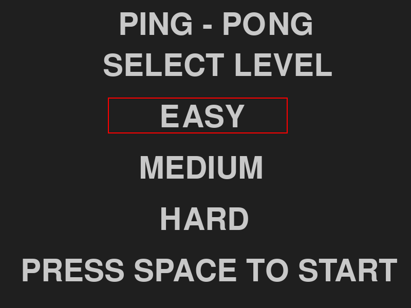
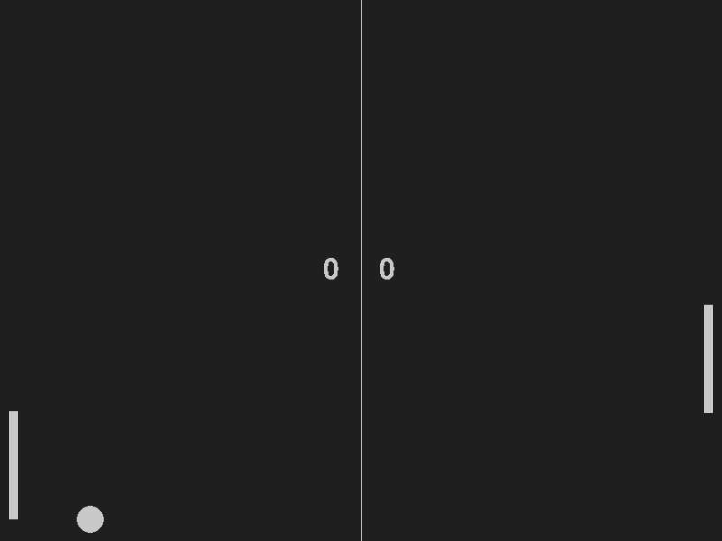

# 🏓 Ping Pong

A minimalist **Pong-style arcade game** built with **Pygame**. Face off against an AI paddle in a neon-dark arena, pick your difficulty, and race to put points on the board.

| 🏠 Main menu | 🎮 In-game |
| :---: | :---: |
|  |  |

## 🎮 Gameplay

- 🧠 AI opponent with three difficulty levels
- ⚡ The ball speeds up slightly after each point
- ⏱️ A **3-2-1 countdown** restarts the rally after every score
- 🖤 Clean dark theme with a centered scoreboard
- 🔊 Bounce (`pong.ogg`) and score (`score.ogg`) sound effects

## 🕹️ Controls

| Action | Key |
| ------ | --- |
| Select difficulty (EASY / MEDIUM / HARD) | `1` / `2` / `3` |
| Start the match | `SPACE` |
| Move your paddle (right side) | `↑` / `↓` |
| Quit | Close the window |

## 🚀 How to Run

```bash
pip install pygame
cd "Ping Pong"
python main.py
```

> ⚠️ Run the game **from inside its folder** — audio assets are loaded with relative paths.

## 📁 Project Structure

```text
Ping Pong/
├── main.py
└── Assets/
    ├── pong.ogg
    └── score.ogg
```

## 🧰 Requirements

- 🐍 Python 3.8+
- 🎮 Pygame 2.x (tested with pygame 2.6.1)
