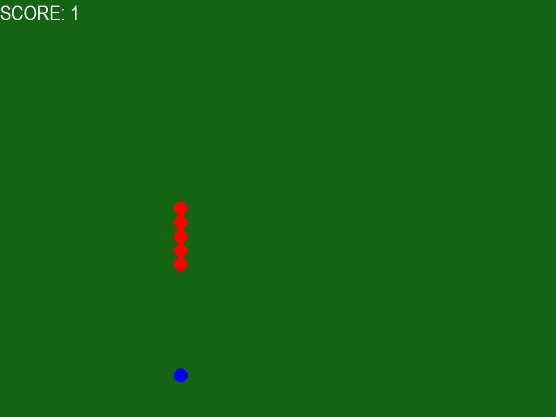
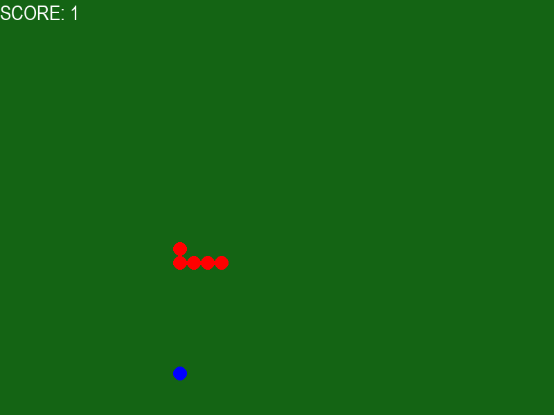

# 🐍 Snake Game

The classic **Snake** built with **Pygame**. Steer the snake around the grid, gobble up apples to grow longer, and see how long you can survive without biting your own tail.

| 🐍 Growing bigger | 🌀 Making a turn |
| :---: | :---: |
|  |  |

## 🎮 Gameplay

- 🍎 Eat the apple to score a point and grow one segment longer
- 🎲 Every apple respawns at a random grid position
- 🧱 Grid-based movement in 20-pixel steps
- 💀 The run ends if the snake head hits its own body — your final score is printed to the terminal
- 🏆 Live **SCORE** shown in the top-left corner

> 💡 **Heads up:** there are no walls or screen wrapping — you can slither off-screen and steer back, but leaving the arena is risky!

## 🕹️ Controls

| Action | Key |
| ------ | --- |
| Steer the snake | `←` `↑` `→` `↓` |
| Quit | Close the window |

## 🚀 How to Run

```bash
pip install pygame
cd "Snake Game"
python main.py
```

> ⚠️ Run the game **from inside its folder** — assets are loaded with relative paths.

## 📁 Project Structure

```text
Snake Game/
└── main.py
```

## 🧰 Requirements

- 🐍 Python 3.8+
- 🎮 Pygame 2.x (tested with pygame 2.6.1)
