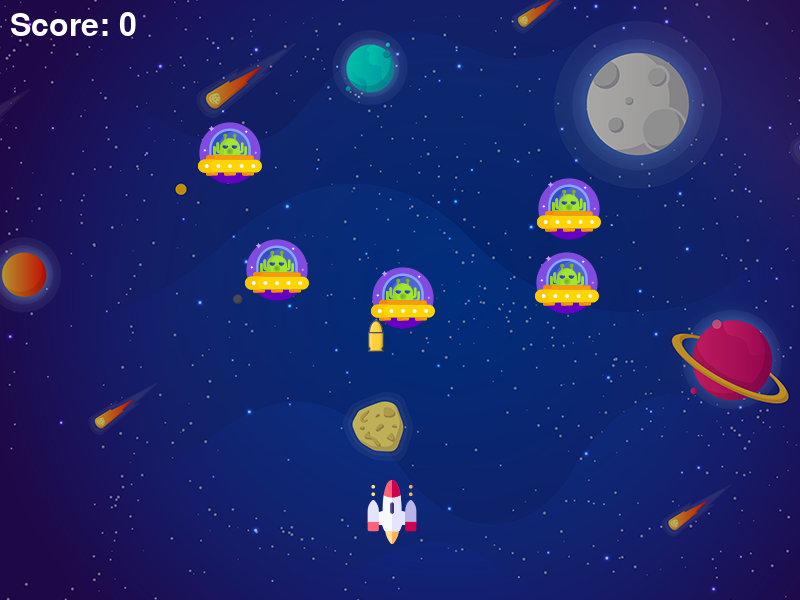
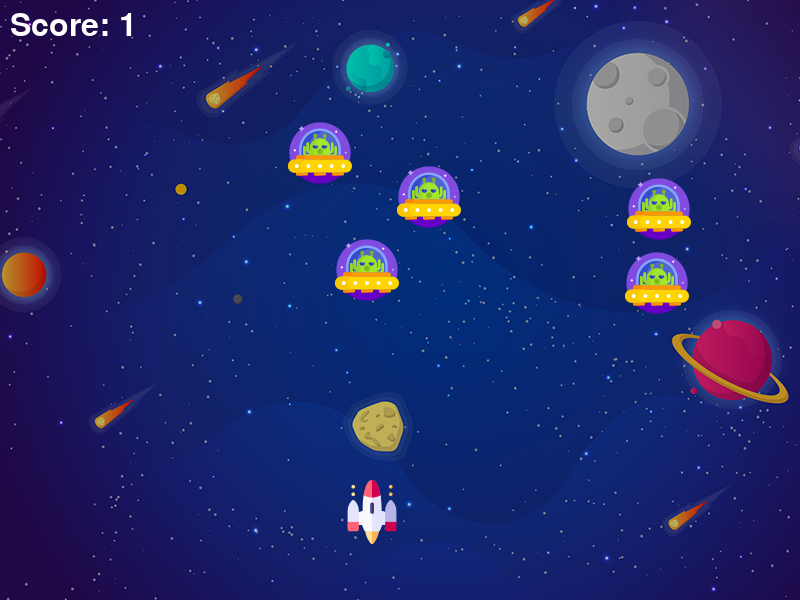

# 👾 Space Invaders

A colorful **Space Invaders** shooter built with **Pygame**. Patrol the starfield, dodge the descending swarm, and blast aliens before they reach the bottom of the screen.

| 🚀 Blasting aliens | 🎯 Lining up a shot |
| :---: | :---: |
|  |  |

## 🎮 Gameplay

- 👽 Five alien ships patrol the sky, changing direction at the screen edges
- 📉 Every edge bounce drops the aliens closer to you
- 🔫 One bullet at a time — make each shot count
- 💥 Hitting an alien scores a point and respawns it at a random spot
- 🛸 Your ship wraps around the left/right edges of the screen
- ☠️ If any alien reaches the bottom, **GAME OVER** is displayed with your final score
- 🎵 Looping background music and laser sound effects

## 🕹️ Controls

| Action | Key |
| ------ | --- |
| Move the ship | `←` `→` `↑` `↓` |
| Fire a bullet | `SPACE` |
| Quit | Close the window |

## 🚀 How to Run

```bash
pip install pygame
cd "Space Invaders"
python main.py
```

> ⚠️ Run the game **from inside its folder** — images and sounds are loaded with relative paths.

## 📁 Project Structure

```text
Space Invaders/
├── main.py
├── Images/   # si, alien, bullet, background
└── Sounds/   # background music, laser, explosion
```

## 🧰 Requirements

- 🐍 Python 3.8+
- 🎮 Pygame 2.x (tested with pygame 2.6.1)
