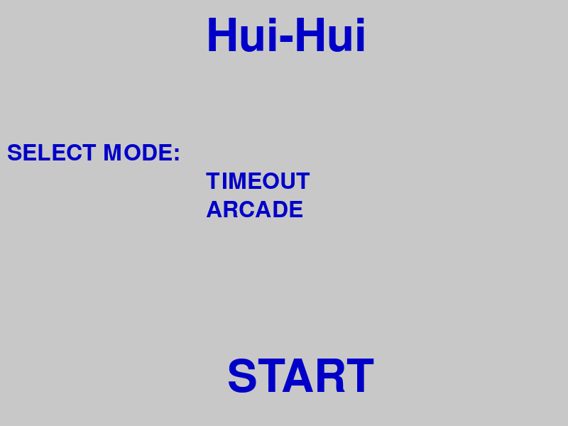
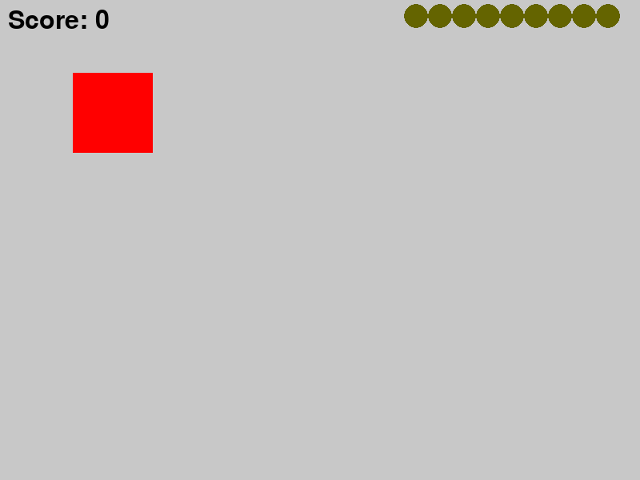

# 🎯 Hui-Hui (Tiles Game)

A fast-paced **reaction and clicking game** built with **Pygame**. A red tile pops up somewhere on screen — click it before it moves on. Choose between a timed score attack and a survival challenge.

| 🏠 Main menu | ❤️ Arcade mode |
| :---: | :---: |
|  |  |

## 🎮 Gameplay

Two modes, one goal: **click the red tile as fast as you can**.

### ⏱️ TIMEOUT

- You have **60 seconds** to score as many points as possible
- Each hit moves the tile to a new random position
- The tile also jumps on its own every second — stay sharp!

### ❤️ ARCADE

- Start with **10 lives** (shown as dots in the top-right corner)
- Clicking the red tile scores a point
- Missing the tile, or letting a second pass without clicking, costs a life
- Game over when your lives run out — the final score is displayed on screen

## 🕹️ Controls

| Action | Input |
| ------ | ----- |
| Select a mode (TIMEOUT / ARCADE) | Left click on the menu |
| Start the game | Left click **START** |
| Hit a tile | Left click the red square |
| Quit | Close the window |

## 🚀 How to Run

```bash
pip install pygame
cd "Tiles Game"
python main.py
```

> ⚠️ Run the game **from inside its folder** — assets are loaded with relative paths.

## 📁 Project Structure

```text
Tiles Game/
└── main.py
```

## 🧰 Requirements

- 🐍 Python 3.8+
- 🎮 Pygame 2.x (tested with pygame 2.6.1)
