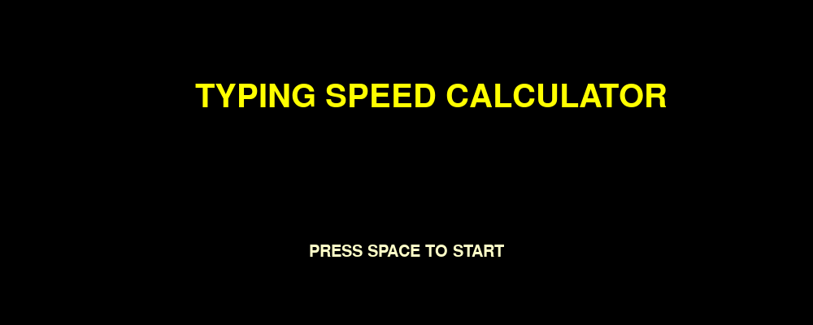
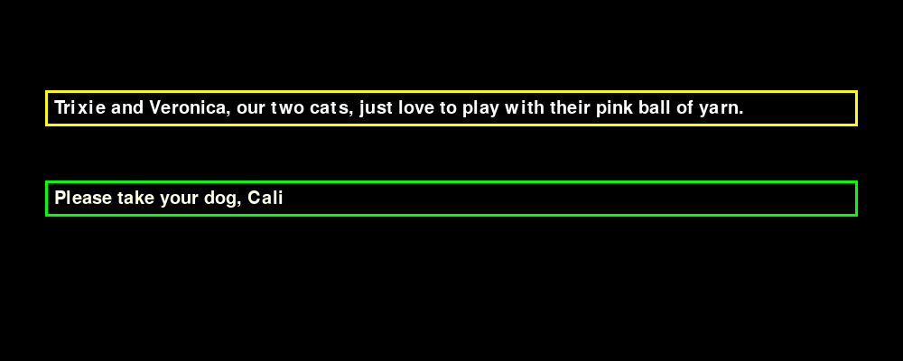

# ⌨️ Typing Speed Calculator

A **typing speed test** built with **Pygame**. Type the sentence shown on screen as quickly and accurately as you can, then check your **WPM** and **accuracy**.

| 🏁 Start screen | ⌨️ Typing a sentence |
| :---: | :---: |
|  |  |

## 🎮 Gameplay

- 📜 A random sentence is picked from a pool of 10
- ⏱️ Press `1` to start the timer, then type the sentence
- ✅ Press `ENTER` to see your **accuracy (%)** and **words per minute (WPM)**
- 🔤 Mistakes are compared character by character against the original sentence
- ↩️ `BACKSPACE` fixes typos, `ESC` returns to the start screen

## 🕹️ Controls

| Action | Key |
| ------ | --- |
| Start the test screen | `SPACE` |
| Begin timing | `1` |
| Type | Any character keys |
| Delete a character | `BACKSPACE` |
| Calculate accuracy & WPM | `ENTER` |
| Back to start screen | `ESC` |
| Quit | Close the window |

## 🚀 How to Run

```bash
pip install pygame
cd "Typing Speed Calculator"
python main.py
```

> ⚠️ Run the game **from inside its folder** — assets are loaded with relative paths.

## 📁 Project Structure

```text
Typing Speed Calculator/
└── main.py
```

## 🧰 Requirements

- 🐍 Python 3.8+
- 🎮 Pygame 2.x (tested with pygame 2.6.1)
